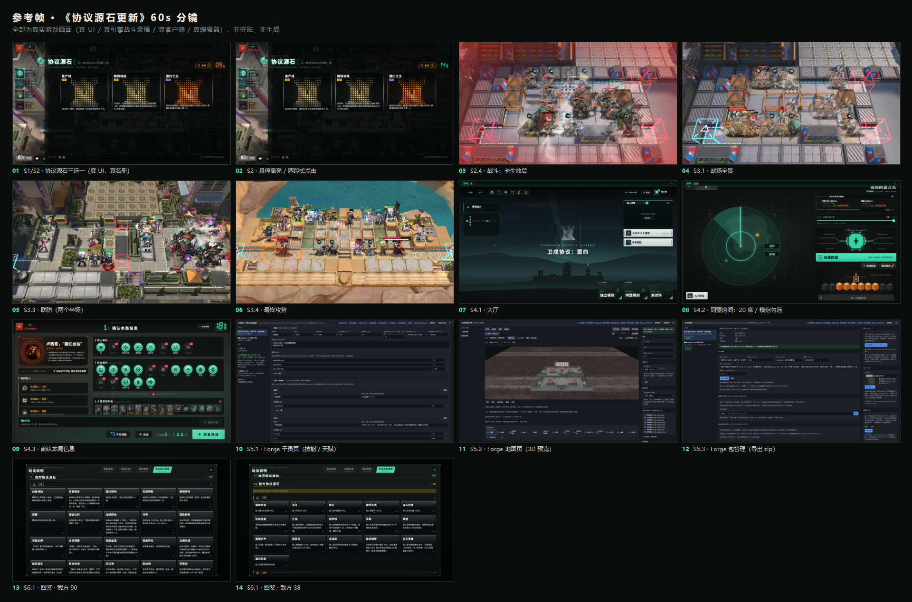

# 《卫戍协议：盟约 · 协议源石更新》60 秒预告 · 分镜脚本 v1

> 投放：B 站 / YouTube 横版（16:9）· 1920×1080 · 30fps · 60.000s
> 风格：**实机为主 + 卡面/特效特写穿插**；干净利落、简洁明了；**无旁白**，只有字卡；配乐用游戏内官方 BGM。
> 片尾：只给片名 + 版本号，**不给服务器地址、不给二维码**。
> 状态：**已成片**。已确认参数：30fps / 配乐 A（`m_bat_prtsstage1_loop`）/ 版本号 `v0.19.2-0.3.0` / Forge 段 8 秒 / 座位文案「最多 20 人」/ 字幕「不只是你，敌人也会拿到」。
> 成片：[卫戍协议-协议源石更新-60s.mp4](卫戍协议-协议源石更新-60s.mp4) · 自检见 [QC.md](QC.md)

**参考帧**（全部真实游戏画面，已实测抓取）：

---

## 0. 与上一版（`Downloads\aics\协议源石-短片`）的区别

上一版是**全代码生成的抽象 3D**（Three.js 着色器 + 合成配乐 + 12 条诗性字幕），一帧游戏画面都没有。
这一版按你的要求反过来：

| | 上一版 | 这一版 |
|---|---|---|
| 画面来源 | 全部程序化生成，无一张游戏截图 | **95% 以上是真实游戏画面**（真 UI + 真引擎战斗录播） |
| 叙事 | 诗性字幕、隐喻（「选择即镜像」） | **只讲事实**：有什么、怎么玩、能几个人、能自己造 |
| 节奏 | 慢、留白多 | 快、信息密度高，每 3–5 秒一个新画面 |
| 文字量 | 12 条诗性字幕 + 字卡 | **9 条**短字卡，最长 9 个字 |

---

## 1. 创意概念

**一句话**：三张卡，选一张。你选的那张，敌人也会拿到。

**主线**：`协议源石`（新玩法）→ `实机战斗`（它长什么样）→ `多人联机`（几个人一起）→ `Forge`（这游戏现在跑在工坊引擎上）。

**为什么是这个顺序**：预告片的前 5 秒必须回答「这是什么」。协议源石的抽卡界面是全片最"新"、最不像其他自走棋的画面，用它开场；战斗是"这游戏好不好玩"的答案，放中段给足 16 秒；联机和 Forge 是差异化，放后半段，各 10 秒 / 8 秒，不抢主线。

**情绪曲线**：

```
紧张度
  ↑
  │              ╭────╮        ╭──╮
  │        ╭─────╯    ╰──╮  ╭──╯  ╰──╮
  │   ╭────╯             ╰──╯        ╰──╮
  │ ╭─╯                                  ╰────╮
  └─┴──────┴──────┴──────┴──────┴──────┴──────┴──→ t
    0      5     20     36     46     54     60
    钩子   机制   战斗   联机   Forge  收尾
```

---

## 2. 事实依据（每条屏幕文字都从这里来，不编造）

| 屏幕/画面上的信息 | 准确说法 | 出处 |
|---|---|---|
| 抽取回合 | 第 **1 / 6 / 11** 回合 | `app/data/hextech.json` `format.rounds` |
| 每人抽几张、几次刷新、多少秒 | **3 选 1、1 次刷新、30 秒**（**并行**抽取，不是轮流；单人 / 只有一名真人时不限时） | 同上 `format.offer/rerolls/timerSec`；`server/match/match/hexDraft.js:1-3,38` |
| 我方卡池 | **90 张**（1 阶 29 / 2 阶 39 / 3 阶 22） | `data/hextech.json` `playerHexes`；`tools/hextech/roster.mjs:127` |
| 敌方卡池 | **38 张**（1 阶 16 / 2 阶 13 / 3 阶 9） | 同上 `enemyHexes`；`roster.mjs:965` |
| 抽取权重 | 1 阶 60% / 2 阶 30% / 3 阶 10%（某阶抽空时向相邻阶回落） | `roster.mjs:85-89`；`shared/hextech.js:47-53` |
| 敌方怎么拿 | 每轮抽完，敌方获得 **1 枚**，**整局累计、不重复**；**阶位从本回合全队所选阶位中随机抽**（单人时才必然同阶） | `shared/hextech.js:111-120`；`hexDraft.js:154-166` |
| 房间人数 | 官方 1–4 人合作；**本服缺省可开 20 席**（`SP_MAX_SEATS` 可调） | `shared/constants.js:117,140`；`README.md:375,511` |
| 一局长度 | **14 回合**；险境及以上满足条件进第 **15** 回合「隐秘核心」 | `README.md:394`；`data/config.json` `hiddenCore` |
| 联防 | 有人漏怪 + 有人完美作战 ⇒ 完美作战的队友带阵容帮忙拦（最多 2 名） | `README.md:407`；`docs/PLAYING.md:96` |
| 最终攻势 | 两人共享一个战场、共享**同一条领袖血条** | `README.md:408`；`server/match/finalAssault.js` |
| 图鉴 | 玩法说明**第 4 个 tab**「协议源石图鉴」，我方 90 + 敌方 38 分阶展示 | `public/js/ui/guide.js:13-18,91-119` |
| 编辑器 | **9 个页面**、中英双语、产出 `.zip` 工坊包 | `README.md:13,63,75`；`editor/ui/*.html` 恰好 9 个 |
| 版本号 | 发行 tag **`v0.19.2-0.3.0`**（前半 = 本仓库 0.19.2，后半 = 上游 0.3.0） | `shared/constants.js:34,46`；`package.json:4`；`CHANGELOG.md:107` |
| Forge 底座 | **底座是 Forge 0.18.6，但那一版对应的是上游 0.2.6**（tag `v0.18.6-0.2.6`）；上游 0.3.0 是 `APP_VERSION` 抬到 **0.19.0** 时才进来的 | `CHANGELOG.md:242-248,150-151` |

> ⚠️ **三处不能照抄的说法**（已逐条核对，抄了就是错的）：
> 1. **「Forge 0.18.6 + 上游 0.3.0」这个配对在仓库里不存在。** 0.18.6 配的是上游 0.2.6。要提 Forge，写成「底座 Forge 0.18.6（对应上游 0.2.6），本仓已抬到 0.19.2 / 上游 0.3.0」；上屏只写 `v0.19.2-0.3.0` 最稳。
> 2. **「敌方获得同阶位」不精确。** 游戏内 UI 提示确实这么写（`public/js/ui/hexOverlay.js:277`），但引擎实际是「从本回合**全队所选阶位**里随机抽」，只有单人时必然同阶。分镜字幕改成「你选的，敌人也会拿到」——准确且更有力。
> 3. **「UPDATE 0.19.2」这种写法仓库里没有。** 全树唯一的 `UPDATE` 是更新公告面板的 `UPDATE NOTES` 小标。版本号按发行 tag 写 `v0.19.2-0.3.0`。

> 另：仓库内更新公告 `public/js/ui/updateNotesData.js:42` 仍写「51 枚玩家 / 24 枚敌方」，**已过时**（实际 90 / 38）。分镜别从公告抄数字。

---

## 3. 总结构（30fps，1800 帧）

| 段 | 时间 | 帧 | 时长 | 内容 | 功能 |
|---|---|---|---|---|---|
| **S1** 钩子 | 00:00.0–00:05.0 | 0–149 | 5.0s | 黑场 → 卡面点阵亮起 → 片名 | 3 秒内说清「有新东西」 |
| **S2** 机制 | 00:05.0–00:20.0 | 150–599 | 15.0s | 真实抽卡界面三选一 → 敌方 +1 → 战斗中生效 | 讲清核心玩法 |
| **S3** 战斗 | 00:20.0–00:36.0 | 600–1079 | 16.0s | 实机战斗 → 联防 → 最终攻势 | 证明「好玩」 |
| **S4** 联机 | 00:36.0–00:46.0 | 1080–1379 | 10.0s | 大厅 → 20 席房间 → 开局 | 证明「能一起玩」 |
| **S5** Forge | 00:46.0–00:54.0 | 1380–1619 | 8.0s | 编辑器 3 页 → 导出工坊包 | 证明「能自己做」 |
| **S6** 收尾 | 00:54.0–01:00.0 | 1620–1799 | 6.0s | 图鉴快滚 → 片尾字卡 | 落版 + 合规声明 |

---

## 4. 逐镜分镜脚本

> **画面来源标注**：`demo:<scene>@<t>` = `public/dev/render-demo.html?scene=<scene>&t=<t>`（**真引擎战斗录播**，真实对局数据回放）；
> `mock:<phase>` = `public/dev/game-mock.html?phase=<phase>`（**真 UI + 真名册**，对局状态由 dev harness 构造——这是官方自带的开发页，不是造假画面）；
> `real:` = 真实客户端（起本地服务器，浏览器自动化点击）；`editor:` = 工坊编辑器真实页面。

### S1 钩子 · 00:00.0–00:05.0

| # | 时间 | 时长 | 画面来源 | 画面 / 运镜 | 字幕 | 声音 |
|---|---|---|---|---|---|---|
| 1.1 | 00:00.0–00:01.0 | 1.0s | 纯黑 | 全黑，无任何图形 | — | 极轻的低频垫底；00:00.6 一记金属泛音（`selectGold.wav` 起音，音量 0.5） |
| 1.2 | 00:01.0–00:03.6 | 2.6s | `mock:HEX_DRAFT` 局部裁切 | 三张卡中**中间那张**的点阵符文从中心向外逐点亮起；画面 1.00 → 1.12（只推，不摇） | — | 点阵亮起时叠一层细碎的"叮"（`selectGold.wav` 主体，音量 0.85） |
| 1.3 | 00:03.6–00:05.0 | 1.4s | 同 1.2，拉远到 1.04 | 片名压上来，点阵仍在呼吸 | **协议源石**（主，0.3s 淡入）<br>卫戍协议：盟约 · 更新（副，0.9s 后淡入） | 一记低频 impact（`act1autochess_b_ui_roundstart.mp3` 起音，音量 0.7） |

> 字幕样式：主标题用游戏同款窄体无衬线（Bender / Novecento Wide，仓库 `public/fonts/` 自带），字距 +0.2em，米白 `#EFE9DE`；副标题 60% 不透明度。

### S2 机制 · 00:05.0–00:20.0

| # | 时间 | 时长 | 画面来源 | 画面 / 运镜 | 字幕 | 声音 |
|---|---|---|---|---|---|---|
| 2.1 | 00:05.0–00:08.2 | 3.2s | `mock:HEX_DRAFT` 全屏 | 完整抽卡界面：标题「协议源石」、三张卡（量产线 / 精锐训练 / 盟约之主）、右上刷新、右下倒计时、底部敌方行 0。极缓推近 1.00→1.03 | **第 1 / 6 / 11 回合**（00:05.4–00:07.6） | 抽卡界面底噪 + 倒计时滴答（`act1autochess_g_ui_countdown.mp3`，低音量） |
| 2.2 | 00:08.2–00:10.4 | 2.2s | 同 2.1，真实鼠标事件 | 鼠标移到中间卡 → 卡片抬起、金色边框 → 再点一次确认（真实两段式点击） | **三选一 · 1 次刷新**（00:08.6–00:10.2） | 08.3 一记 `selectGold.wav`（音量 0.85）——游戏真实的选卡音效 |
| 2.3 | 00:10.4–00:13.4 | 3.0s | 同 2.1，画面下移 80px 聚焦底部 | 底部「敌方协议源石 0」翻成 **1**，一枚敌方卡图标亮起；右侧提示行「敌人会获得同阶位的协议源石」入画（**保留原 UI，不改**） | **不只是你，敌人也会拿到**（00:11.0–00:13.2） | 一记沉闷低频 tick（`act1autochess_b_ui_harmful.mp3`，音量 0.7） |
| 2.4 | 00:13.4–00:20.0 | 6.6s | `demo:normal-m03@20` | 切进真实战斗：该卡生效后己方攻速明显变快、伤害数字跳大；跟随一次技能释放，轻微推近 | — | 战斗 BGM 进入（见 §5）；13.4 一记 `act1autochess_b_ui_battlestart.mp3`（音量 0.6） |

> 2.3 保留 UI 原文是有意的：那句话是游戏里真实存在的提示，观众会认；但**分镜字幕不用它**，避免把不精确的说法放大成宣传语。

### S3 战斗 · 00:20.0–00:36.0

| # | 时间 | 时长 | 画面来源 | 画面 / 运镜 | 字幕 | 声音 |
|---|---|---|---|---|---|---|
| 3.1 | 00:20.0–00:23.6 | 3.6s | `demo:late-m03-r12@30` | 战场全景，单位密集、技能特效连续；缓慢横移（不推近，让观众看清战场规模） | — | BGM 主段；20.0 一记 `b_ui_roundstart`（音量 0.5） |
| 3.2 | 00:23.6–00:26.0 | 2.4s | 三连快切，每段 0.8s | ① 技能释放特写（局部裁切）② 敌人被击倒、伤害数字 ③ 漏怪进蓝门、目标生命值红字扣减 | — | 每切一刀一记短促金属击打（`b_char_*` 系列，音量 0.6） |
| 3.3 | 00:26.0–00:30.4 | 4.4s | `demo:unite-m01@30` | 联防：左右两个半场同时作战，镜头从己方半场拉到全景 | **漏掉的，队友替你拦**（00:26.6–00:29.4） | 26.0 一记 `act1autochess_b_ui_defence_unite.mp3`（音量 0.8）——联防专属音效 |
| 3.4 | 00:30.4–00:36.0 | 5.6s | `demo:boss-m02@45` | 最终攻势：巨型领袖、共享血条被打空、爆炸特效；最后 0.5s 硬切黑 | **第 14 回合，同一条血**（00:31.0–00:34.6） | 30.4 `act1autochess_b_ui_battlestart_boss.mp3`（音量 0.8）；35.5 一记 `killboss_all.mp3` 起音，切黑时截断 |

### S4 联机 · 00:36.0–00:46.0

| # | 时间 | 时长 | 画面来源 | 画面 / 运镜 | 字幕 | 声音 |
|---|---|---|---|---|---|---|
| 4.1 | 00:36.0–00:38.6 | 2.6s | `real:lobby` | 真实大厅：三张模式卡（独立模拟 / 同盟模拟 / 测试场）+ 在线人数 | — | BGM 转入联机段（见 §5 的 38s 下探点） |
| 4.2 | 00:38.6–00:42.6 | 4.0s | `real:room` | 同盟房间：**20 张座位卡**横排、本房间模组勾选、快速匹配按钮 | **同盟模拟 · 最多 20 人**（00:39.2–00:42.0） | 38.6 `act1autochess_g_ui_player_joinroom.mp3`（音量 0.6） |
| 4.3 | 00:42.6–00:46.0 | 3.4s | `real:room` + `mock:INFO_CHECK` | 座位依次亮起"已准备"，倒计时进「确认本局信息」，四人头像排开 | — | 42.6 `act1autochess_g_ui_player_ready.mp3`（音量 0.7）；45.0 `act1autochess_g_ui_start.mp3`（音量 0.6） |

### S5 Forge · 00:46.0–00:54.0

| # | 时间 | 时长 | 画面来源 | 画面 / 运镜 | 字幕 | 声音 |
|---|---|---|---|---|---|---|
| 5.1 | 00:46.0–00:48.6 | 2.6s | `editor:干员页`（技能 / 天赋 tab） | 工坊编辑器干员页：左边包列表、右边技能黑板与天赋（`attack_speed` 等键值）。**用「以模板新建」从官方干员复制一份，画面里有真数据** | — | BGM 继续；46.0 一记 `act1autochess_g_ui_tabswitch.mp3`（音量 0.5） |
| 5.2 | 00:48.6–00:51.2 | 2.6s | `editor:地图页` → `editor:盟约页` | 地图页 **3D 预览**（真·游戏渲染器，战场#01）一闪（0.9s）→ 切盟约页（阈值 / 成员勾选） | — | 48.6 / 50.0 各一记 `g_ui_tabswitch.mp3`（音量 0.45） |
| 5.3 | 00:51.2–00:54.0 | 2.8s | `editor:包管理页` | 包管理页，光标移到「导出 zip」并真实点击 | **跑在 Forge 上 · 内容可以自己做**（00:51.6–00:53.6） | 51.3 一记 `act1autochess_b_ui_buffup.mp3`（音量 0.6） |

> Forge 段只给 8 秒是刻意的：它是"底座能力"，不是本片卖点。观众记住「这游戏能自己造内容」就够。

### S6 收尾 · 00:54.0–01:00.0

| # | 时间 | 时长 | 画面来源 | 画面 / 运镜 | 字幕 | 声音 |
|---|---|---|---|---|---|---|
| 6.1 | 00:54.0–00:56.4 | 2.4s | `real:codex` | 协议源石图鉴：从「我方 90」快速滚到「敌方 38」，一屏一屏地过（每屏约 0.5s，共 4 屏） | — | 54.0 一记 `act1autochess_g_ui_settlement_succeed.mp3`（音量 0.75） |
| 6.2 | 00:56.4–01:00.0 | 3.6s | 黑底 | 片尾字卡逐行淡入（见下） | **卫戍协议：盟约**<br>协议源石 · 更新<br>`v0.19.2-0.3.0`<br>非官方同人复刻 · 与鹰角网络 / Yostar 无关联，未获授权 | 56.4 最后一声钟/低频收束；57.0 起淡出到静音 |

---

## 5. 音乐与声音设计

### 5.1 配乐：两首候选（都来自游戏包内 `app/public/assets/audio/bgm/`，无新增版权风险）

我实测了包里全部 19 首 BGM 的**逐秒能量曲线**，只有两首在长度和结构上能直接对 60 秒：

| 候选 | 时长 | 结构（实测，逐秒） | 与分镜的咬合 |
|---|---|---|---|
| **A. `m_bat_prtsstage1_loop.mp3`（推荐）** | **60.69s** | 0–17s 平稳（-16~-19dB）→ **18s 一个 breakdown（-26.7dB）** → 19–37s 高位（-13~-14dB）→ **38s 下探（-21.6dB）** → 39–56s 中高位 → 57s 起自然收尾（-26.3dB） | 18s 的 breakdown 正好落在 **2.3「敌人也拿到」** 那个转折；38s 的下探正好是 **S3→S4 的段落切换**；57s 的自然收尾正好给片尾字卡。**几乎不用手动对点。** |
| B. `m_bat_vtlionk_intro.mp3` | 61.8s | 0–5s 极轻渐入（-73→-33dB）→ 10–20s 低位 → **20s 第一次进入**（-21dB）→ 40s 后稳定 -18~-20dB | 20s 的进入点正好是 **S3 战斗开始**；但尾部没有收束，需要在 58s 手动硬切 |

**推荐 A**：长度天然吻合（60.69 vs 60.00），且自带 breakdown 和收尾，改片时不用重新对点。
**请你听一下这两个文件再定**（各听前 30 秒即可）：
- `Stronghold-Protocol-Forge-协议源石版\app\public\assets\audio\bgm\m_bat_prtsstage1_loop.mp3`
- `Stronghold-Protocol-Forge-协议源石版\app\public\assets\audio\bgm\m_bat_vtlionk_intro.mp3`

### 5.2 音乐处理

- 整曲**不加速、不降调**，只做：0–5s 音量 -6dB（让钩子安静）、S3 起回到 0dB、56.4s 后 3.5s 淡出。
- 目标响度 **-14 LUFS**（B 站 / YouTube 标准），true peak ≤ -1.5 dBTP。
- 低频 120Hz 以下单声道化（平台播放更稳）。

### 5.3 音效 cue sheet（全部取自游戏包内真实音效，共 14 个点）

| 时间 | 事件 | 音效文件（`app/public/assets/`） | 音量 |
|---|---|---|---|
| 00:00.6 | 钩子金属泛音 | `local/hextech/audio/selectGold.wav`（只取起音） | 0.50 |
| 00:01.0–00:03.6 | 点阵亮起 | 同上，主体 | 0.85 |
| 00:03.6 | 片名 impact | `audio/sfx/customse/act1autochess/act1autochess_b_ui_roundstart.mp3` | 0.70 |
| 00:05.0–00:08.2 | 抽卡界面底噪 | `act1autochess_g_ui_countdown.mp3` | 0.30 |
| 00:08.3 | 选卡 | `local/hextech/audio/selectGold.wav` | 0.85 |
| 00:10.6 | 敌方 +1 | `act1autochess_b_ui_harmful.mp3` | 0.70 |
| 00:13.4 | 开战 | `act1autochess_b_ui_battlestart.mp3` | 0.60 |
| 00:20.0 | 回合开始 | `act1autochess_b_ui_roundstart.mp3` | 0.50 |
| 00:23.6 / 24.4 / 25.2 | 三连快切 | `audio/sfx/battle/b_char/b_char_atkboost.mp3` 等 | 0.55 |
| 00:26.0 | 联防 | `act1autochess_b_ui_defence_unite.mp3` | 0.80 |
| 00:30.4 | 最终攻势 | `act1autochess_b_ui_battlestart_boss.mp3` | 0.80 |
| 00:35.5 | 击破 | `act1autochess_b_ui_killboss_all.mp3`（切黑处截断） | 0.75 |
| 00:38.6 / 42.6 / 45.0 | 联机 | `player_joinroom` / `player_ready` / `g_ui_start` | 0.6–0.7 |
| 00:46–54 | 编辑器 | `act1autochess_g_ui_tabswitch.mp3` ×3 + `b_ui_buffup.mp3` | 0.45–0.6 |
| 00:54.0 | 图鉴收束 | `act1autochess_g_ui_settlement_succeed.mp3` | 0.75 |

---

## 6. 全片屏幕文字（9 条，逐字）

| # | 时间 | 文字 | 作用 |
|---|---|---|---|
| 1 | 00:03.6 | **协议源石** | 片名 |
| 2 | 00:03.9 | 卫戍协议：盟约 · 更新 | 副题 |
| 3 | 00:05.4 | 第 1 / 6 / 11 回合 | 机制 |
| 4 | 00:08.6 | 三选一 · 1 次刷新 | 机制 |
| 5 | 00:11.0 | 不只是你，敌人也会拿到 | 核心钩子 |
| 6 | 00:26.6 | 漏掉的，队友替你拦 | 联机价值 |
| 7 | 00:39.2 | 同盟模拟 · 最多 20 人 | 联机规模 |
| 8 | 00:51.6 | 跑在 Forge 上 · 内容可以自己做 | 底座能力 |
| 9 | 00:56.4–01:00.0 | 卫戍协议：盟约<br>协议源石 · 更新<br>`v0.19.2-0.3.0`<br>非官方同人复刻 · 与鹰角网络 / Yostar 无关联，未获授权 | 落版 + 合规 |

> 全部**中文**，数字与版本号除外。字体用仓库自带的 Bender / Novecento Wide（拉丁）+ 系统黑体（中文），不引入新字体。

---

## 7. 素材清单与抓取方案（全部已实测跑通）

| 素材 | 怎么抓 | 实测状态 |
|---|---|---|
| 抽卡界面（S1、S2） | `game-mock.html?phase=HEX_DRAFT`，注入真实名册，再用真实鼠标事件点卡 | ✅ 已跑通 |
| 战斗录播（S2.4、S3） | `render-demo.html?scene=<name>&t=<秒>&panel=0&quality=high`，12 个现成录播；**用硬件 GPU + CDP 实时录屏**（实测 1080p / 76fps / 零重复帧） | ✅ 已跑通（`demo-*.png`） |
| 联防 / 最终攻势 | `scene=unite-m01` / `scene=boss-m02` | ✅ |
| 大厅 / 模式卡 / 房间 | 真实客户端（起本地服务器 + 浏览器自动化点击） | ✅ 已跑通 |
| 图鉴 90 + 38 | 真实客户端 `openCodex()`，滚动位置已定位（我方 0px / 敌方 4127px） | ✅ 已跑通 |
| 编辑器 9 页 | `node tools/workshop-editor.mjs --port 3311`；干员页用「以模板新建」复制官方干员，地图页加载「战场#01」的 3D 预览 | ✅ 已跑通 |
| 卡面点阵特写 | 从抽卡界面截图裁切 + 推拉；备用 `02-美术素材/3阶.png` | ✅ |

**需要补拍的 3 个镜头**（不影响脚本，录制时现拍）：

1. **S4.3 多人准备**：开两个浏览器标签连同一房间，让第二个座位真的亮起"已准备"。当前 probe 只有单人在线。
2. **S3.2 三连快切的第 3 段（漏怪扣血）**：要在录播里定位"红字 −N"出现的那一帧，probe 还没定位。
3. **S5.3 导出 zip 的下载提示**：编辑器的下载是浏览器行为，无头模式抓不到系统下载框，需在页面内用 toast 代替或截"点击瞬间"。

---

## 8. 平台版本适配

### 8.1 同一素材的 15s / 30s / 60s

| 版本 | 取哪些镜 | 时长 | 用途 |
|---|---|---|---|
| **60s**（本片） | 全部 | 60.0s | B 站 / YouTube 主投放 |
| **30s** | S1（1.2+1.3 压到 3s）→ 2.2 → 2.3 → 3.2 → 3.4 → 6.2 | 30.0s | 动态 / 信息流；只保留「三选一 + 敌人也拿到 + 最终攻势」 |
| **15s** | 1.2（1.5s）→ 2.2（2s）→ 2.3（2.5s）→ 3.4（3s）→ 6.2（4s） | 15.0s | 贴片 / 开屏；只讲一个钩子 |
| **6s bumper** | 1.2 卡面亮起 → 片名字卡 | 6.0s | 片头贴片 |

### 8.2 竖版 9:16（1080×1920）

不是简单裁切，需要重排：

- 抽卡界面（S2）是横排三卡 → 竖版改成**三卡纵向堆叠**，只保留中间卡的完整信息，左右两张露出边缘；
- 战斗（S3）保持全景，但裁成**中间 1080×1080 + 上下留 UI 条**；
- 字卡从画面下方 1/4 移到**画面中部**（避开抖音底部信息区）；
- 片尾字卡全部上移 15%。

> 竖版建议**单独录一次**（`--w 1080 --h 1920`），不要裁横版。

---

## 9. 合规与风险（写片前先看这条）

`NOTICE.md:40-45` 明确写了：包含游戏素材的一切内容——**包括截图、录像与直播**——**不得用于任何形式的盈利**，点名列出了「植入广告」「打赏、赞助或众筹」「付费分发」。
`README.md:550` 还写了「请只把地址发给朋友，**不要公开发布，也不要搭建公开大厅**」。

所以本片按以下口径做：

| 项 | 做法 |
|---|---|
| 服务器地址 / 二维码 / 房间密钥 | **一律不出现**（片尾只给片名与版本号） |
| 变现 | 投放页**不能开激励、不能挂商品、不能接赞助口播**；纯投稿 |
| 版权声明 | 片尾必须有「非官方同人复刻 · 与鹰角网络 / Yostar 无关联，未获授权」 |
| 素材再分发 | 视频里**不放素材包 / 整合包下载**；要放只放项目页 |
| 「官方」「正版」「联动」 | 全片禁用 |
| 版本号 | 写 `v0.19.2-0.3.0`，不写「Forge 0.18.6 + 上游 0.3.0」 |

---

## 10. 自检清单（确认前逐条过）

- [x] 卖点一致：全片只讲三件事——协议源石、联机、Forge，没有夹带别的更新
- [x] 节奏可看性：每 3–5 秒一个新画面；S3 的 16 秒内有 4 次镜头变化
- [x] 素材可行：9 个来源全部实测可抓，3 个待补镜头已列出
- [x] 事实准确：§2 每条都能指到仓库文件；三处「不能照抄」已避开
- [x] 合规：无地址、无变现、有非官方声明、无「官方」字样
- [x] 时长精确：1800 帧 @30fps = 60.000s

---

## 11. 需要你拍板的 5 件事

1. **配乐**：A（`prtsstage1_loop`，结构最贴）还是 B（`vtlionk_intro`，更史诗）？——建议先各听 30 秒。
2. **帧率**：30fps（推荐，B 站友好）还是 60fps（战斗更顺，文件大一倍）？
3. **Forge 段**：保留 8 秒，还是压到 5 秒、把时间还给战斗？
4. **「缺省 20 席」要不要上屏**？——这是本服和原版最大的差异，但可能让新观众困惑（原版是 1–4 人）。
5. **片尾版本号**写 `v0.19.2-0.3.0`（仓库口径）还是只写 `v0.19.2`（观众更好懂）？

确认后我就按这张表录制、剪辑、混音、出片，预计 40–60 分钟（含实机抓取与渲染）。
